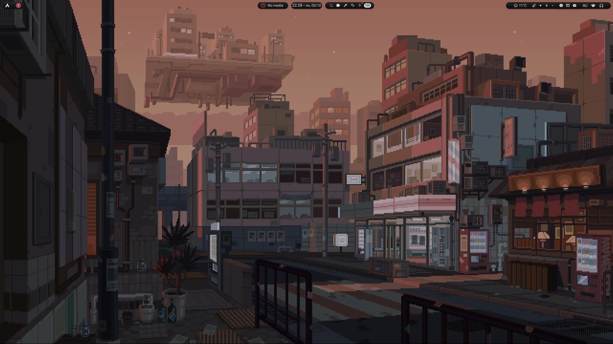
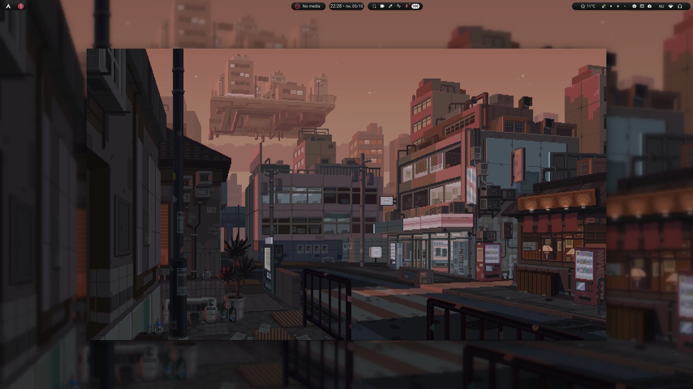
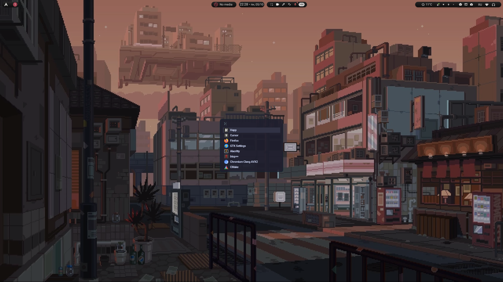
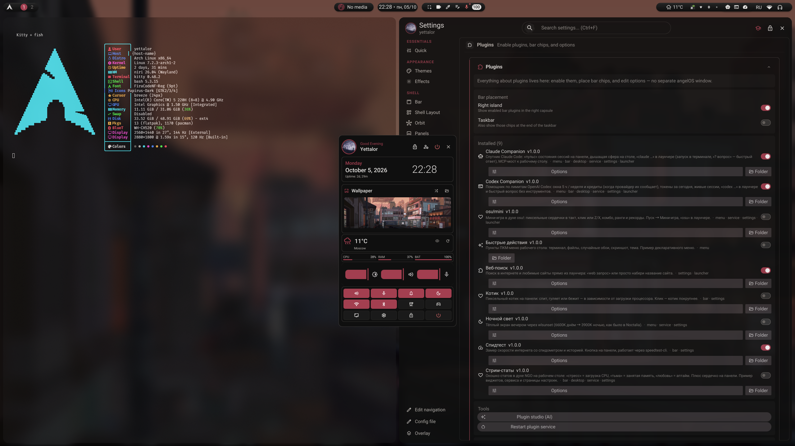
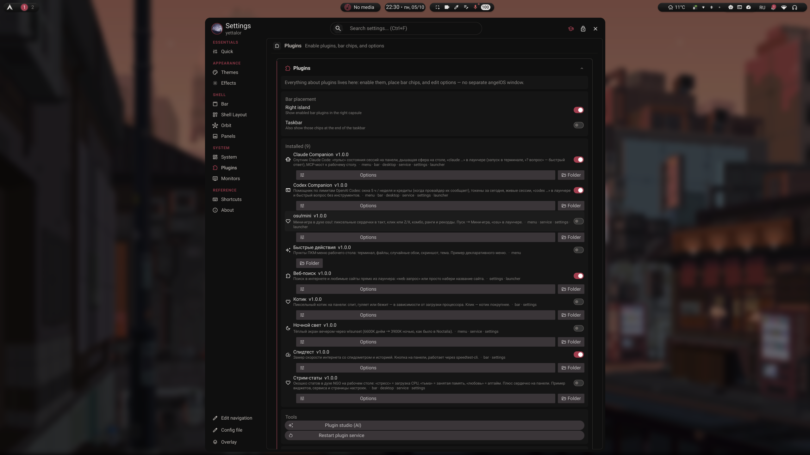
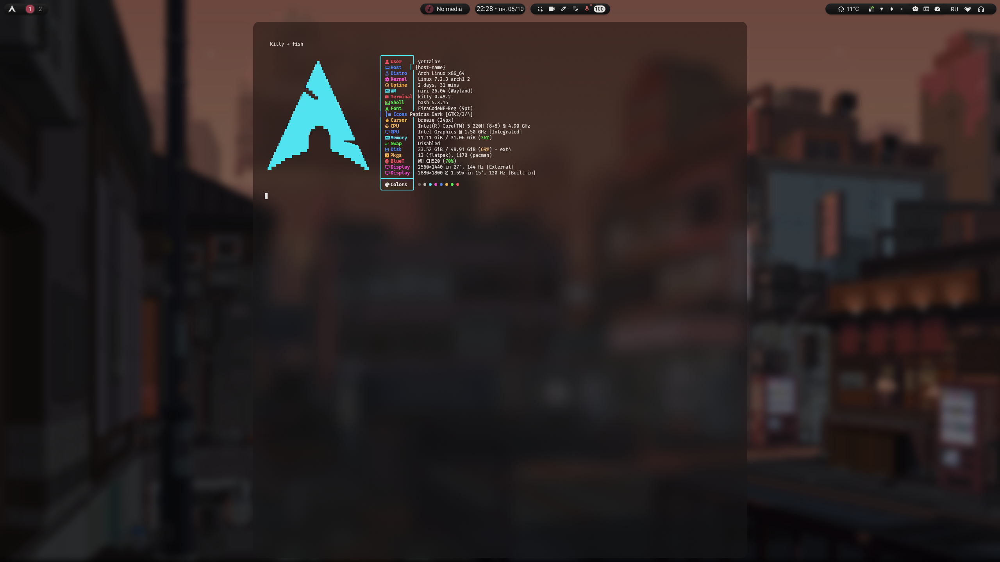
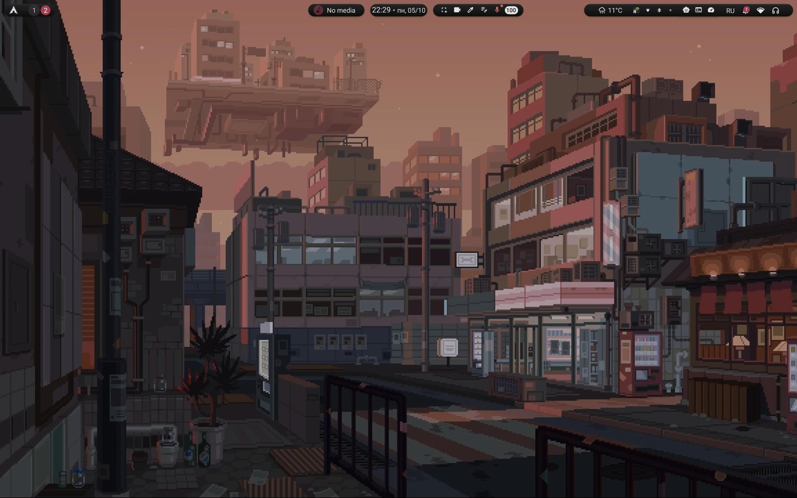

<div align="center">

# Niri Dots

**Arch Linux** · [Niri](https://github.com/YaLTeR/niri) · [iNiR](https://github.com/snowarch/inir) · Kitty

Личный снапшот рабочего стола — один конфиг, без чужих waybar/minimal-стеков.

[](https://github.com/YaLTeR/niri)
[](https://github.com/snowarch/inir)
[](https://sw.kovidgoyal.net/kitty/)
[](https://archlinux.org/)

Снято с **ARZOPA 27″** · HDMI · `2560×1440@144`

</div>

---

## Preview

| Desktop | Overview |
|:-------:|:--------:|
|  |  |
| *Пустой стол (HDMI)* | *Niri overview* |

| Launcher | Control panel |
|:--------:|:-------------:|
|  |  |
| *iNiR overview / apps* | *Быстрые настройки* |

| Settings | Terminal |
|:--------:|:--------:|
|  |  |
| *iNiR · Plugins* | *Kitty + fish + fastfetch* |

<p align="center">
  
  <br />
  <sub>Ноутбук · eDP · пустой workspace</sub>
</p>

---

## Stack

| Layer | Choice |
|-------|--------|
| Compositor | **Niri** 26.04 |
| Desktop shell | **iNiR** (Quickshell) |
| Terminal | **Kitty** |
| Shell | fish + Starship |
| Icons | Papirus-Dark |
| Cursor | capitaine-cursors-light |
| Portals | xdg-desktop-portal-gnome (ScreenCast) + gtk |
| Plugins | `quickshell/inir-plugins` |

---

## Keybindings

`Mod` = Super/Win. Полный список в сессии: **Mod+/** (iNiR cheatsheet).  
Конфиг: `configs/niri/config.d/70-binds.kdl`, личное — `90-user-extra.kdl`.

### Applications

| Keys | Action |
|------|--------|
| `Mod+T` / `Mod+Return` | Terminal (Kitty) |
| `Super+W` | Browser |
| `Super+E` | Files (Nautilus) |
| `Mod+Space` | iNiR overview / launcher |
| `Mod+Tab` | Niri overview |

### Shell & UI

| Keys | Action |
|------|--------|
| `Mod+,` | iNiR settings |
| `Mod+Ctrl+P` | Plugins page |
| `Mod+/` | Cheatsheet |
| `Mod+V` | Clipboard history |
| `Super+G` | Overlay tools |
| `Ctrl+Alt+T` | Wallpaper picker |

### Windows & workspaces

| Keys | Action |
|------|--------|
| `Mod+Q` | Close window |
| `Mod+D` | Maximize column |
| `Mod+F` | Fullscreen |
| `Mod+1` … `Mod+9` | Focus workspace |

### Capture & media

| Keys | Action |
|------|--------|
| `Mod+Shift+S` / `Ctrl+Shift+S` | Region screenshot |
| `Print` / `Ctrl+Print` / `Alt+Print` | Screen / output / window |
| `Mod+Shift+R` | Record with sound |

### Session

| Keys | Action |
|------|--------|
| `Mod+L` | Lock |
| `Mod+Shift+Q` / `Ctrl+Alt+Delete` | Session menu |
| `Mod+Ctrl+O` | Quran Reminder |

---

## Layout

```text
dotfiles/
├── README.md
└── media/
    └── screenshots/     # HDMI captures (ARZOPA 27″)
```

Полный инсталлятор и конфиги живут в локальном пакете **Yettalor-Niri-Dots** (`./install.sh`).  
Этот репозиторий — превью и документация снимка рабочего стола.

---

## Notes

- Мониторы и DPI править под себя в `90-user-extra.kdl` после установки.
- Не запускать upstream `setup` из чужого клона поверх этого снапшота.
- Экспорт: `2026-10-05` · niri `26.04`.
